# Nimbus

A calm travel-and-productivity companion. Nimbus puts a trip and a calendar on one
timeline, finds the stretches of travel you can actually work in, and warns you
before a time-zone change turns a meeting into a midnight call.

**Status: phase 1 of 5.** The whole UI runs on realistic mock data with no
backend. See [Roadmap](#roadmap) for what each phase adds.

## The problem

People who travel for work lose two things: the usable hours hidden inside a
trip (a gate wait, a long flight, a ride in from the airport) and the sanity of
a calendar that was built in one time zone and lived in another. Existing tools
show flights *or* meetings, never the shape of a day that contains both. Nimbus
treats travel as part of the workday and plans around it.

## What it does

| Screen | What you get |
| --- | --- |
| **Today** | One vertical timeline per day, travel on the left and work on the right. On a flight day, a leave-now card computes when to head out from the flight time, the time you want at the airport, and the travel time you enter. |
| **Focus** | Every travel gap of 20 minutes or more, labelled by context, length, connectivity and work mode. Tasks that fit are suggested; one tap plans them in. |
| **Shield** | Meetings that land between 10 PM and 7 AM in the destination zone, each with a suggested slot and a one-tap reschedule note you can copy. |
| **Prep** | The evening before a flight: a checklist of downloads derived from the tasks you planned for the flight, plus the standard items. |
| **Metrics** | Product events and the north-star metric, focus minutes planned per trip. |

Nimbus the cloud appears only when something needs attention. White and still for
a nudge, a little greyer with a gentle bob for a warning. Never more than one on
screen.

### Screenshots

| | |
| --- | --- |
| 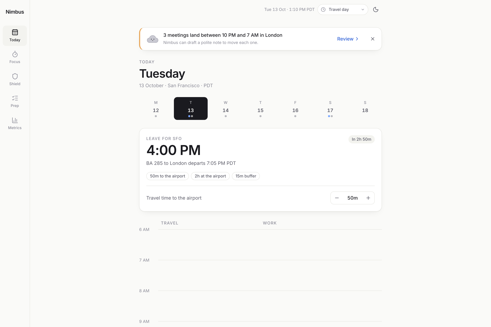 | 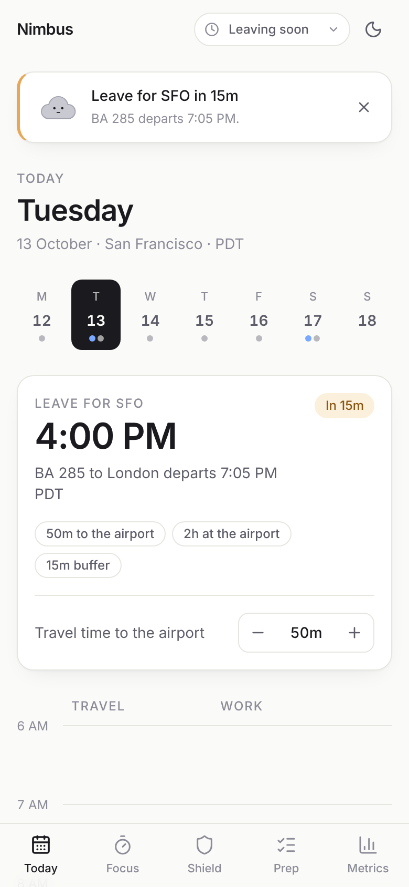 |
| 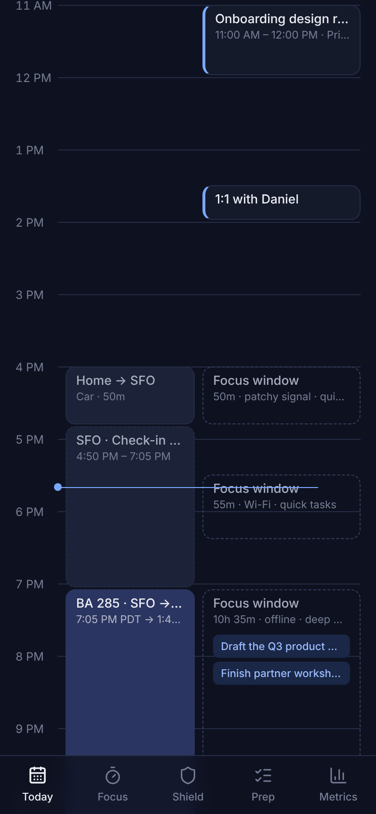 | 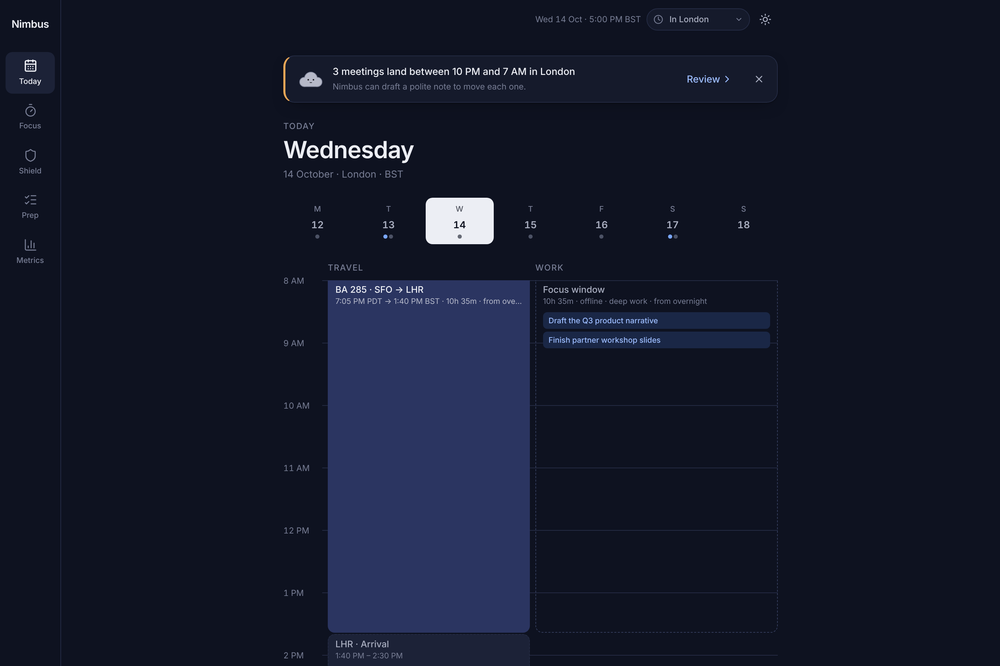 |
| 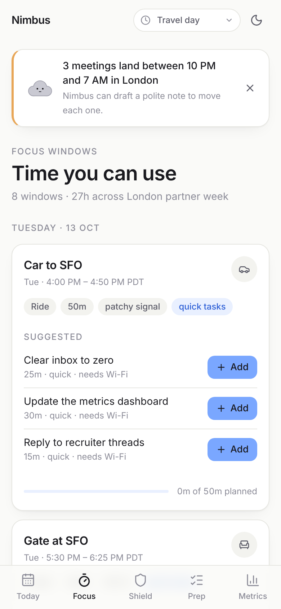 | 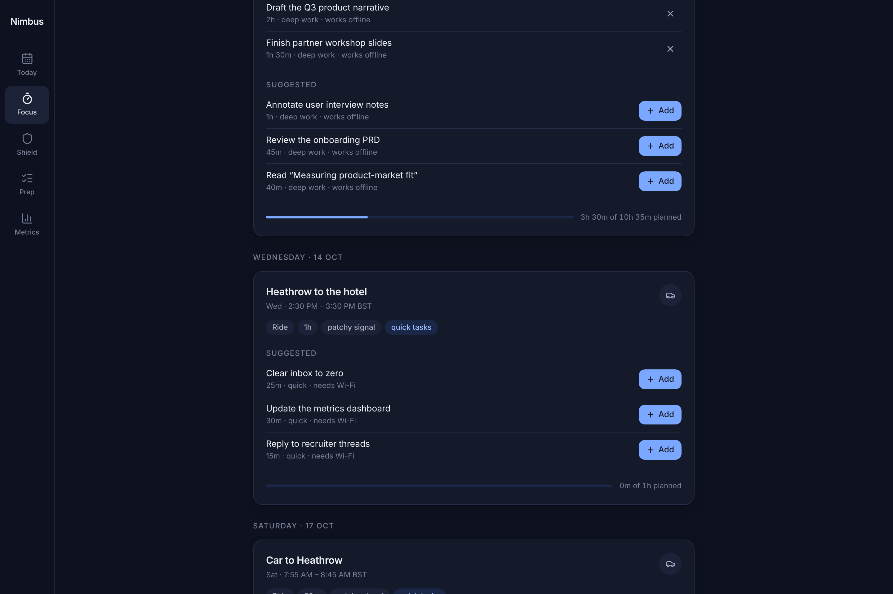 |
| 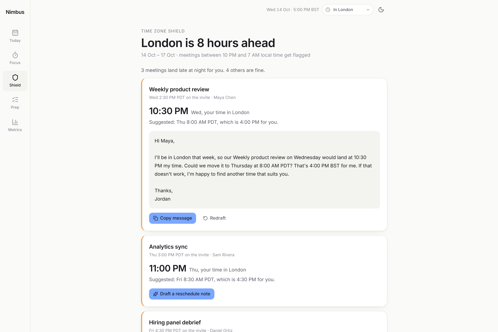 | 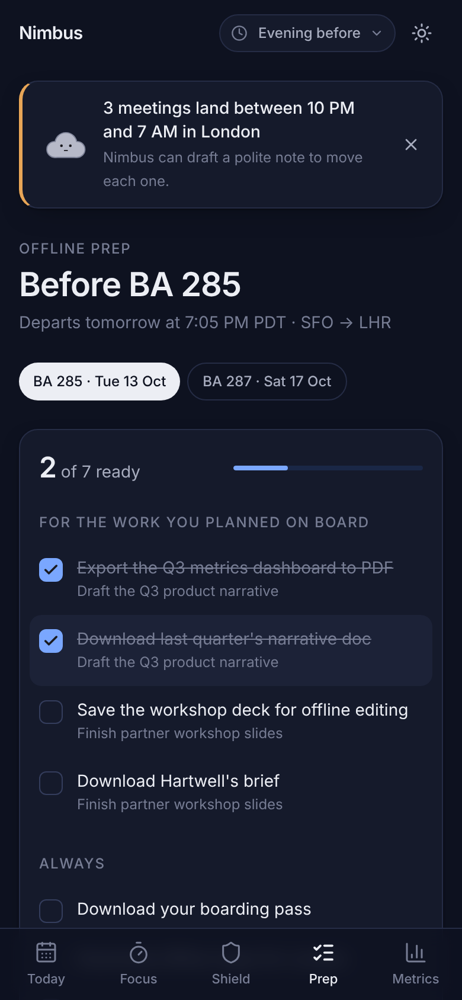 |
| 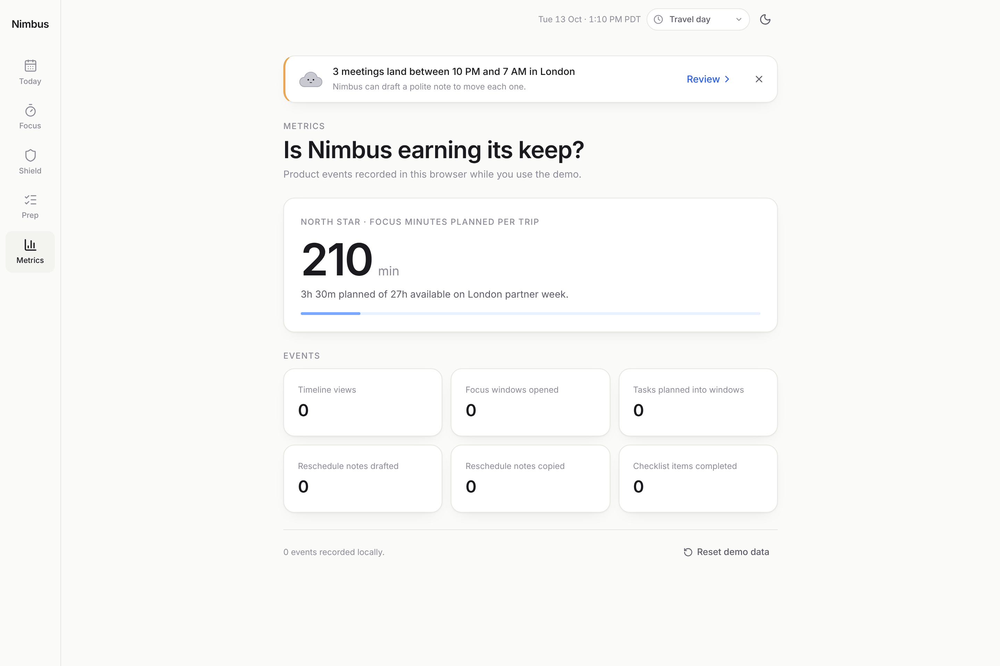 | 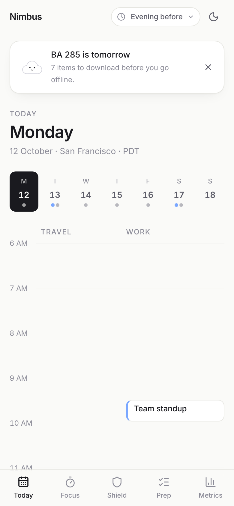 |

## Run it locally

Requires Node 22. No AWS account, no API keys.

```bash
cd nimbus
npm install
npm run dev        # http://localhost:3000
```

Other scripts, all from `nimbus/`:

```bash
npm run check      # typecheck + lint + unit tests, every workspace
npm test           # core algorithm tests (Vitest)
npm run build      # static export to apps/web/out
npm run preview    # serve the static export on http://localhost:3000
```

### The demo clock

The sample week is pinned to 12 through 18 October 2026, so the app runs on a
demo clock. The pill in the top right jumps to moments where each feature lights
up: the evening before the flight, travel day, leaving soon, at the gate, and in
London. "Live clock" uses the real time. Your choices (planned tasks, checklist
ticks, travel time, drafted notes, events) persist in the browser's localStorage;
"Reset demo data" on the Metrics page clears them.

## Architecture

The domain lives in one pure TypeScript package. The browser and, from phase 3,
the Lambdas run the same code against different adapters.

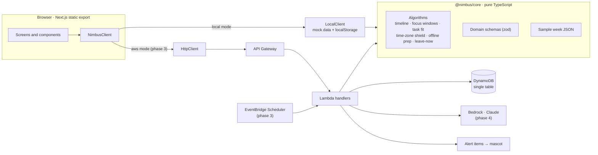

Key choices:

- **One contract, two clients.** The UI only talks to `NimbusClient`. Local mode
  is a full implementation in the browser, which is why the app is demoable
  without a backend and why Google Calendar or a flight-status API can be added
  later as new adapters without touching the screens.
- **Static frontend.** Nothing in the app needs a server, so `next build`
  produces plain files that can be hosted on S3 and CloudFront.
- **Zero-dependency time zones.** All zone math is built on `Intl`, with the
  tricky parts (local to UTC, DST-length days) covered by tests.
- **One day, one zone, no repeats.** Each day is shown in the zone you wake up
  in. When the zone changes, the day starts where the previous day ended, so the
  first day in London starts at 8 AM (midnight Pacific) and nothing appears on
  two days.

### Project structure

```
nimbus/
├── apps/web/            Next.js App Router + Tailwind v4
│   └── src/
│       ├── app/         routes: /, /focus, /shield, /prep, /metrics, /preview
│       ├── components/  shell, mascot, timeline, focus, shield, prep, metrics, ui
│       └── lib/         NimbusClient, state provider, selectors, attention rules
├── packages/core/       domain schemas, time helpers, algorithms, mock data, tests
├── docs/screenshots/
└── .env.example
```

`/preview` renders every screen in one static file with in-memory navigation,
for hosts that can only serve a single page.

## Design

- **Tokens.** Off-white `#FAFAF8` and ink `#1A1A1F`, sky blue `#7AA7FF` as the
  single accent, amber `#E8A657` only for warnings, deep navy `#0E1220` in dark
  mode. Every color is a CSS variable, so dark mode is a token swap, not a second
  stylesheet. Text on the accent and amber uses darker shades of the same hues to
  keep contrast above 4.5:1.
- **Type.** Inter, self-hosted at build time. Large headings, small quiet
  metadata.
- **Motion.** 150 to 250 ms ease-out transitions and one 2.4 s bob for the
  mascot. `prefers-reduced-motion` disables all of it.
- **Accessibility.** Skip link, landmarks, `aria-current` navigation, native
  checkboxes and selects, labelled icon buttons, visible focus rings, a live
  region for toasts.

## Metrics

Six product events are tracked:

`timeline_viewed` · `focus_window_viewed` · `task_assigned_to_window` ·
`reschedule_message_generated` · `reschedule_message_copied` ·
`checklist_item_completed`

**North star: focus minutes planned per trip.** For each focus window, count the
smaller of the window length and the total estimated minutes of tasks planned
into it, sum over the trip, and average across trips. In phase 1 events live in
localStorage; phase 5 moves them to DynamoDB with a metrics endpoint.

## Deploy to AWS

Phase 3. The CDK app will create the DynamoDB table, API Gateway, Lambda
functions, an EventBridge Scheduler group and an optional S3 + CloudFront stack
for the static export, with a cost section in this README.

## Roadmap

1. **UI with mock data** (done): every screen, design system, mascot, demo clock.
2. **Core logic and tests**: computed focus windows and time-zone flags replace
   the hand-authored fixtures; edge-case tests for midnight, DST and overnight
   flights.
3. **AWS backend**: CDK, single-table DynamoDB, Lambdas, Scheduler alerts, HTTP
   client, seed script.
4. **Claude features**: Bedrock task suggestions and reschedule notes with a
   template fallback.
5. **Analytics and metrics**: events in DynamoDB, metrics endpoint, chart.
