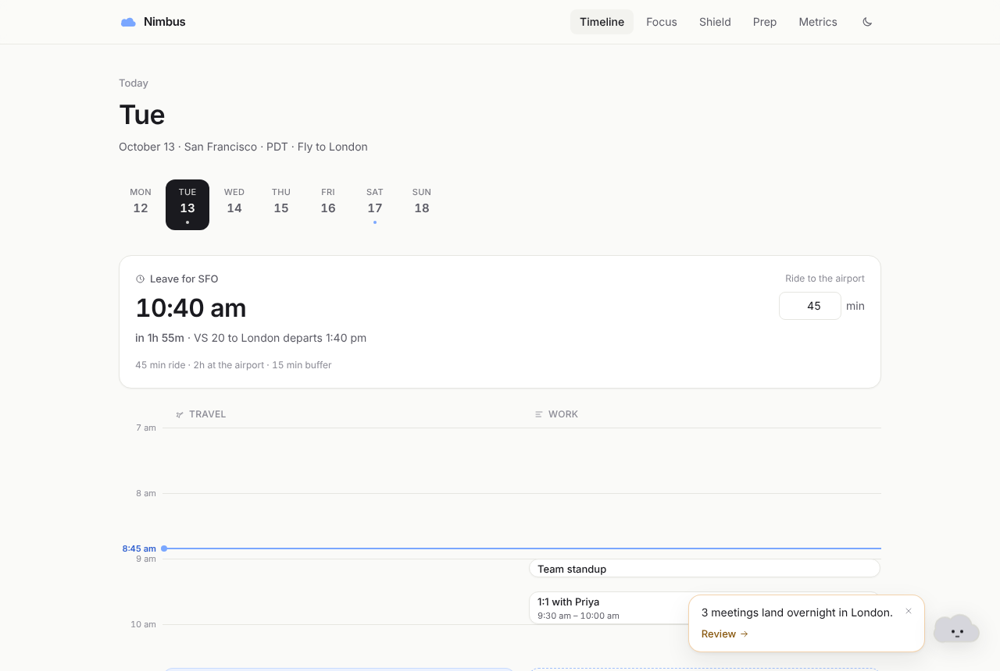
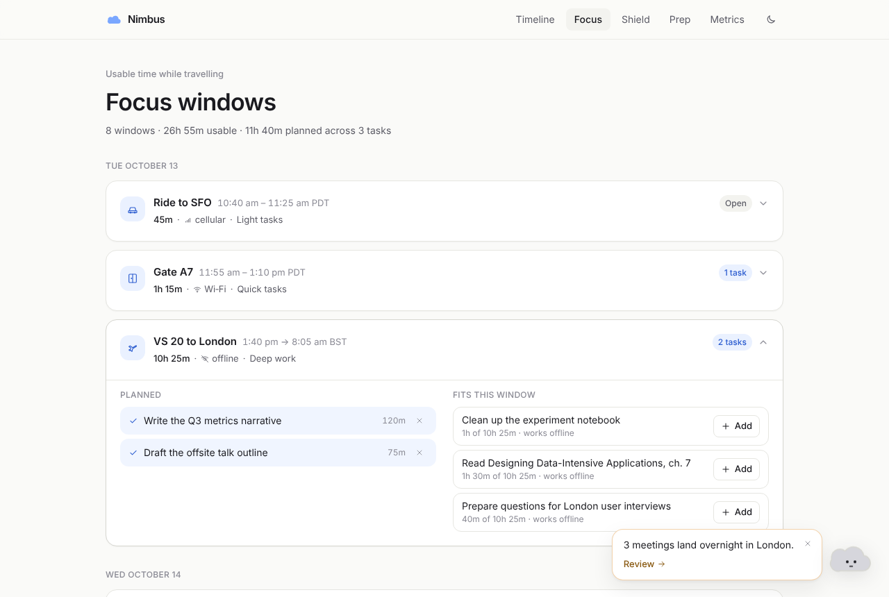
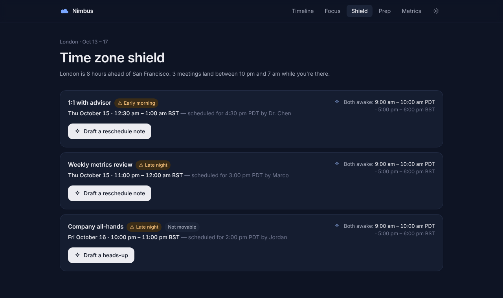
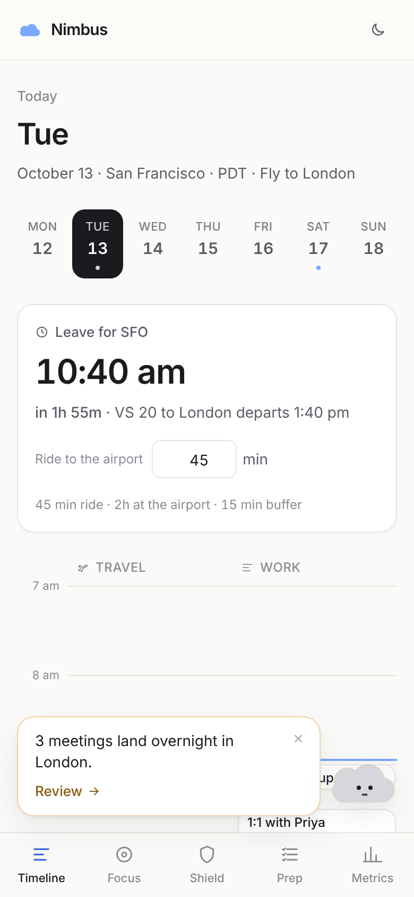

# Nimbus

A calm travel-and-productivity companion. Nimbus merges your calendar and your trip into one timeline, finds the time you can actually use while travelling, and warns you before a meeting lands at 2 am in your new time zone.

> Status: **Phase 2 of 5** — the full UI runs locally against a realistic sample week, and the core algorithms are covered by unit tests. The AWS backend, Claude-written reschedule notes, and the metrics page follow in later phases.

## The problem

People who travel for work lose two kinds of time. The obvious kind is the travel itself: rides, security lines, gate waits, flights. The sneaky kind is the planning overhead around it: working out when to leave, what to download before going offline, and which recurring meetings will now fall in the middle of the night. Calendars show appointments; trip apps show flights; nothing shows the two together or tells you what to do with the gaps.

Nimbus does five small things well:

| Feature | What it does |
| --- | --- |
| **Unified timeline** | One vertical day with travel on the left and work on the right, on the same clock. |
| **Focus windows** | Finds gaps of 20+ minutes inside rides, gate waits, trains and flights, labels them by length and connectivity, and suggests tasks that fit. |
| **Time zone shield** | Flags meetings that land between 10 pm and 7 am in the destination zone and drafts a polite reschedule note. |
| **Offline prep** | The evening before a flight, lists what to download, built from the tasks you planned for that flight. |
| **Leave-now card** | Given a flight and your ride time to the airport, says when to leave, with a buffer. |

A small cloud named Nimbus appears only when something needs attention. There is never more than one on screen.

## Screenshots

| Timeline | Focus windows |
| --- | --- |
|  |  |

| Time zone shield (dark) | Phone |
| --- | --- |
|  |   |

## Run it locally

Requires Node 22 (see `.nvmrc`). No AWS account, API keys or network calls are needed in mock mode.

```bash
cd nimbus
npm install
cp .env.example .env     # defaults to NIMBUS_MODE=mock
npm run dev              # http://localhost:3000
```

Other scripts, all from `nimbus/`:

```bash
npm run check            # typecheck + lint + tests across every workspace
npm run test             # core algorithm tests (Vitest)
npm run build            # production build of the web app
```

### Tests

The core package has a test file per module (`packages/core/src/*.test.ts`). The interesting cases:

- **Focus windows**: a gap of exactly 20 minutes is kept and 19 is dropped; overlapping and touching meetings merge; a meeting that overlaps the start of a block shifts the window's id (`gate@15`), so an assignment never silently moves to a different gap; your own task blocks don't split a window.
- **Time zone shield**: the 10 pm and 7 am boundaries are exact (a meeting ending at 10:00 pm is fine, one ending 10:01 pm is not); meetings that cross midnight count; the destination's own DST change is followed (a 3 pm Pacific meeting is 11 pm in London one week and 10 pm the next); the suggested alternative is the first hour inside working hours in both zones, including the last hour of the day.
- **Timeline**: an overnight flight is clipped at midnight on the departure day and starts at midnight, in the arrival zone, on the arrival day; positions use the wall clock, so a 25-hour day still lines up with its hour labels.
- **Leave-now**: buffers by domestic or international, delays push the leave time, and the status steps through later, soon, now, late, departed at the right minutes.
- **Offline prep**: opens at 5 pm the evening before in the departure zone and closes at departure; items come only from tasks planned on that flight.
- **Attention**: leaving wins over clashes, which win over the checklist; the checklist only counts while it is open and unfinished.

The demo is pinned to a fixed "now" (`NIMBUS_DEMO_NOW` in `.env`) so the sample week always looks the same: the morning of a San Francisco → London flight, with three meetings that will land overnight in London. Set it to `real` to use the clock.

## How it is put together

```
nimbus/
├── packages/core   @nimbus/core — pure TypeScript domain logic, no React, no AWS
│   └── src/
│       ├── timeline.ts        merge travel + work onto one day axis
│       ├── focusWindows.ts    gaps ≥ 20 min inside travel, labelled by length + connectivity
│       ├── taskFit.ts         rank tasks that fit a window
│       ├── timezoneShield.ts  10 pm – 7 am clashes, alternative slots, reschedule template
│       ├── offlinePrep.ts     checklist from the tasks planned for a flight
│       ├── leaveNow.ts        departure − airport buffer − ride − contingency
│       ├── flights.ts         shift travel blocks when a flight is delayed
│       ├── attention.ts       the one thing the mascot should point at
│       ├── sources/           CalendarSource / FlightSource / TaskSource interfaces + mock impls
│       └── mock/sample-week.json
├── web             Next.js (App Router) + Tailwind
│   ├── app/            one route per feature, server components read from NimbusApi
│   ├── components/     small, typed components; client components only where there is interaction
│   └── lib/server/     NimbusApi contract + the in-process local implementation
└── infra           AWS CDK (arrives in Phase 3)
```

Two seams keep the integrations swappable:

- **Data sources** (`packages/core/src/sources`). The app depends on `CalendarSource`, `FlightSource` and `TaskSource`. The mock implementations read the sample week; a Google Calendar source or a flight-status API slot in behind the same interfaces.
- **NimbusApi** (`web/lib/server/api.ts`). Pages and server actions call one contract. In `mock` mode it runs in-process; in `aws` mode it will forward to API Gateway with the API key kept on the server, so the browser never sees it.

### Design

- Palette: off-white `#FAFAF8`, ink `#1A1A1F`, one accent `#7AA7FF`, amber `#E8A657` reserved for warnings, deep navy `#0E1424` in dark mode. Accent and amber are used for fills and lines; text on them uses darker, contrast-checked variants.
- Type: Inter, self-hosted. Large headings, small quiet metadata, tabular numerals for times.
- Motion: 150–250 ms ease-out, nothing else. `prefers-reduced-motion` turns it all off, including the mascot's bob.
- Accessibility: semantic landmarks, `aria-current` navigation, labelled icon buttons, visible focus rings, a skip link, and a timeline that is also a plain list to a screen reader.

## Roadmap

1. ~~UI with mock data~~
2. ~~Core logic hardening + unit tests for focus-window detection and time-zone logic~~ (this phase)
3. AWS backend: CDK, API Gateway + Lambda, single-table DynamoDB, EventBridge Scheduler alerts
4. Claude on Amazon Bedrock for task suggestions and reschedule notes
5. Analytics events in DynamoDB and the `/metrics` page with the north-star metric, focus minutes planned per trip

## License

Portfolio project. Mock data is fictional.
